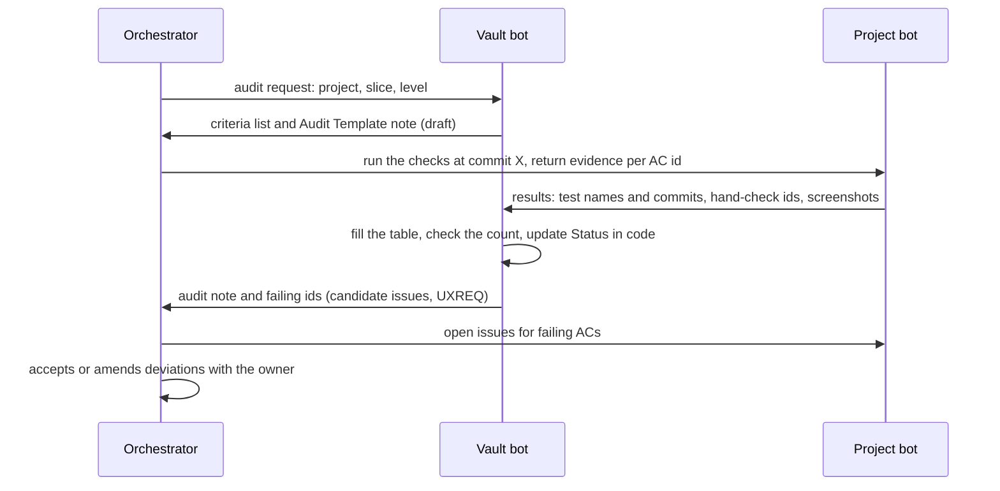

# 17 Conformance

> [!info] Summary
> How a Tesserae project says that it follows the specifications, and how the claim is checked: three conformance levels, the acceptance criterion (AC) identifier as the unit of a claim, the audit note and its result values, how failing criteria are tracked, what each project's test harness has to provide, how the specification is versioned, how a project records a deviation, and the audit workflow routed through the Orchestrator. The test types are in [[Test Method]]; the audit skeleton is [[Audit Template]].

## Scope

Applies to every project that draws visual elements and claims to follow the UX Design Specification or the UX Component Design Specification: tess-ui (toolkit and apps), tess-shell (the shell and its modules), tre (engine primitives the specification relies on) and later projects. The vault never promises that a project adopts a rule; adoption is the project's decision ([[01 Principles and Scope]], How to read the specification). This chapter defines what a claim means once a project makes one.

## Unit of conformance: the AC identifier

- The unit is the acceptance criterion `AC-<prefix>-<n>` in a chapter, foundation or component note. A claim, an audit row, a defect and a deviation each cite an AC id.
- An id is unique across the vault, never renumbered and never reused. A criterion that stops applying is marked `withdrawn` in its note with the date and the reason and stays in the list (vault rule 7: never delete notes).
- An AC without a marker is a MUST. A criterion that is a SHOULD carries `(SHOULD)` right after the id. MAY behaviour has no criterion unless it is present, and then it follows the stated form ([[01 Principles and Scope]], Conformance language).
- Each AC names one of the eight test types of [[Test Method]] and a pass condition in numbers. A criterion without a type is a defect of the vault (AC-TM-1).
- Rules in chapters that carry MUST in capitals and no AC are defects of the vault (AC-PRI-3); a project is audited only against criteria.

## Conformance levels

A level is a set of ACs. A project claims one level for one scope (the slices it draws).

| Level | Name | Contains | Needed for the claim |
|---|---|---|---|
| 1 | Foundations | every MUST AC in `10 UX Design Specification` chapters (01, 02, 07, 10, 11, 12, 14, 15) and in `20 Foundations and Tokens` | no `fail` and no `not run` among them |
| 2 | Components | Level 1 plus every MUST AC of each component note of the elements the project draws in the claimed scope, and of the patterns in `40 Patterns` it uses | no `fail` and no `not run`; rows for elements the project does not draw are `not applicable` |
| 3 | Verified | Level 2 plus every SHOULD AC, every hand check run on a real compositor and every screen-reader review (Orca, NVDA, VoiceOver) recorded as passed | no `fail`, no `not run`, no `not testable` without a recorded review |

Rules:

- A claim is binary for its level and scope. A percentage ("90 percent conformant") is not a claim. The `Status in code` table of a note may say "partly meets": that is a distance, not a claim.
- A claim at a higher level includes the lower ones. A project may claim Level 2 for the slice "Tooltip, Scrollbar, Tree, Text Field" and nothing for the rest.
- A declared deviation (below) leaves a criterion failing and does not count as pass; a claim lists its declared deviations by AC id: "Level 2, with declared deviations AC-SCB-21".
- `not testable` is allowed for a criterion the platform cannot drive (a real screen reader, an input grab on a given compositor). It names why and what review replaces it; it counts for Levels 1 and 2 only when that review exists with a named reviewer and date.

## The claim

A claim is one statement in the project's own documentation (its README or a conformance page) in this form:

```text
Conforms to the Tesserae UX Specification 0.1.0 (vault commit <hash>), Level 2,
scope: Tooltip, Scrollbar and Scroll Container, Tree, Text Field.
Audit: Audit tess-ui Text Field 2026-12-01 and others (links). Project commit <hash>.
Declared deviations: AC-SCB-21 (project ADR-0042).
```

A claim has: the project and its commit, the specification version and the vault commit, the level, the scope (slices or element names), the audit notes that support it and the list of declared deviations. A claim older than the last major change of a note in its scope is stale and says so until re-audited (versioning below).

## Results of a criterion

[[Test Method]] allows pass, fail with defect and not run with reason. The audit format of this chapter adds two values that the data needs:

| Result | Meaning | Required in the row |
|---|---|---|
| pass | the check ran at the project commit and the pass condition held | evidence: test name and commit, hand-check id, or screenshot path |
| fail | the check ran and the pass condition did not hold | issue link; a declared deviation adds its project ADR link |
| not run | the check was not run (no test, no time, no device) | the reason |
| not testable | no automated or hand check can drive it in this environment | why, and the review that replaces it |
| not applicable | the project does not draw the element the criterion is about | which element is absent |

The count at the end of an audit is the five numbers; they sum to the number of rows (AC-TM-3 extended). "Looks right" is not evidence ([[Test Method]]).

## The audit

- One note per project and slice in `70 Adoption`, named `Audit <project> <slice> <date>`, `type: audit`, from [[Audit Template]]. The frontmatter and the table columns are in the template.
- One row per criterion of the audited notes; no row is omitted. The check type column repeats the type the criterion names.
- The audit states the project commit it ran against, the vault commit and specification version, the environment (headless or real compositor, scale factors, schemes) and the date, and ends with the count.
- A failing row has an issue link in the project's tracker (owner column names the person or bot). The audit does not fix code.
- After an audit the vault updates the `Status in code` table of each audited note from the audit and links it ([[Test Method]], audit rules). A status is `meets` when every MUST AC of the note passes in the audit, `partly meets` with the failing ids otherwise, `absent` when the element does not exist and `not applicable` when the criterion does not fit the project.
- Re-audits after fixes are delta audits: a new audit note that lists only the rows that failed or were `not run`, links the earlier audit, and carries the new results; the project's claim cites both.

## Tracking failing criteria

| Where | What |
|---|---|
| The audit note | the row with result `fail`, the issue link and the owner; it is the record of that date |
| The project's tracker | one issue per failing AC or per defect that fails several, with the AC ids in the title ("AC-TXF-5: text field label is not ellipsised"), a link to the audit, and the label `ux-spec` |
| The `Status in code` table | the failing ids of a `partly meets` row |
| [[80 Requests]] | a failure that needs something the engine or toolkit does not have becomes a request note `UXREQ-###`, routed through the Orchestrator, never a silent workaround ([[Plan]]) |
| The next audit | every id that failed is re-run; an id that passes closes its issue and the row records the new evidence |

An issue stays open until the criterion passes at a project commit, a deviation is declared and accepted, or the vault withdraws or changes the criterion.

## Per-project harness expectations

A project provides the means to pass or fail each type of [[Test Method]]. The audit records "no harness" as `not run` with that reason; it never records it as pass.

| Expectation | tess-ui (pytest, headless) | tess-shell (pytest plus hand checks) | tre (cargo and pytest) |
|---|---|---|---|
| Where tests live | `tests/test_<component>.py`, `tests/test_a11y*.py` | `tests/` with the fakes `fake_kwin`, `fake_dbus`, `fake_input_server`, `fake_portal` and the AT-SPI helper | `crates/*` unit tests and Python binding tests under `tests/` |
| Environment | `tests/real_session.py` removes the display and bus; software Vulkan (lavapipe); a hand run on the real session needs `TESS_UI_ALLOW_REAL_SESSION=1` | pytest on fakes; surfaces that need KWin use the KWin kits and the "Hand Checks" note | tests choose themselves per `python3 -I tools/tests_for.py`; no full suite without the owner's word |
| Token test | read stylesheets and token tables (`theme.py`, `tokens.py`, `*_Stylesheet.tdl`); a scan for colour literals | read `Default_Stylesheet.tdl` and `look.py` through the ADR-0001 role mapping | not applicable: tre owns no tokens |
| Geometry check | `View` in an `App`, `window.advance(ms)`, `layout_x`, `layout_y`, `layout_width`, `layout_height` | module tests in a headless tre window | engine properties asserted in binding tests (`overflow`, `max_length`, `scroll`) |
| Pixel check | `window.snapshot()` indexed as RGBA | module snapshots; surface pixels only as hand checks | `window.snapshot()` in binding tests |
| Contrast script | new, in `tests/` (none exists) | new (none exists; shell accessibility rule 9) | not applicable |
| Scripted input | `window.simulate` and `advance`; the key-only config-app test | module tests; KWin behaviour is a hand check with a recorded script | `window.simulate` in binding tests |
| AT tree assertion | `node.get("role")`, `label`, `description`, state flags; `simulate("a11y_action")` | role and state keys of the built tree; real screen reader = hand check, not run today | AccessKit consumer checks and AT-SPI `Announcement` on a private bus |
| Review | checklists from [[Accessibility Rules]] and the chapter ACs | the same plus the shell vault Hand Checks | the Status in code properties |

Conventions that make evidence resolvable:

- A test that proves an AC carries the AC id in its name or marker (for example `test_ac_txf_5_label_ellipsis`), so an audit can cite it and a script can map ids to tests.
- A hand check follows the format of [[Test Method]] (id, steps, expected, environment, observed, tester, date) and is cited by id.
- The project states which environment each result came from; a headless result does not stand for a real-compositor behaviour (KWin popups, grabs, screen readers).
- The contrast script exists in the project, runs on light, dark and high contrast and exits non-zero when a pair fails (AC-TM-2).

## Versioning of the specification

- The specification has one version, `MAJOR.MINOR.PATCH`, for the whole vault. While the notes are `draft` the version is `0.x`; `1.0.0` is set by the owner when the first slice is accepted. The version is recorded in the publishing pull request and as a git tag on `main` named `spec-<version>` by the owner or the Orchestrator (bots do not tag, [[ADR-0008 Publishing flow]]) #needs-verification-as-design-choice.
- MAJOR: a MUST criterion is added, removed or tightened (a stricter number, a new required behaviour), or a token value changes. A claim made under an earlier major is stale until a delta audit.
- MINOR: a SHOULD criterion is added, a note or an element is added, a criterion is loosened or clarified without changing what passes. An earlier claim stays valid for what it covers.
- PATCH: wording, links, sources, status tables. No criterion changes.
- Each note keeps `updated:` and a short change line in its commit; the vault commit hash identifies the exact text a claim was audited against.
- Withdrawn criteria stay with `withdrawn` and a replacement link; ids are not reused.
- An audit is valid for the version and vault commit it names. Moving a claim to a newer version needs the delta audit of the criteria that changed; [[Open Questions]] lists decisions still open.

## Recording deviations by a project

A deviation is a project's decision not to meet a criterion, or to meet it another way. It is recorded where the project records decisions, not in the vault.

1. The project writes an ADR in its own repository (its own numbering) that cites the vault note and the AC ids, states the reason, the scope, the owner of the decision and a review date.
2. A deviation from a MUST criterion needs the owner's acceptance, given through the Orchestrator and cited in the ADR; a deviation from a SHOULD needs the project's own acceptance.
3. The audit row stays `fail`; the issue link is replaced or joined by the project ADR link, and the claim lists the id as a declared deviation.
4. When several projects deviate for the same reason, the vault may amend the criterion or record the reason in [[Deviations from MD3]] (for departures from Material Design 3) through a proposed ADR in `50 Decisions`; the vault author never accepts its own ADR ([[01 Principles and Scope]]; vault guide rule 4).
5. A deviation is reviewed at its review date; a deviation without a date is a defect.

A departure from Material Design 3 by the vault itself (desktop density, keyboard-first use, accessibility) is recorded in the note's Deviations table and in the register [[Deviations from MD3]], not in a project ADR.

## Audit workflow routed through the Orchestrator

Audits are assigned and routed by `bot:Orchestrator`; the vault bot reads code read-only and never fixes it, never pushes to a project and never opens an issue without instruction (vault guide rules 5 and 8).



Steps:

1. Request. The owner or the Orchestrator names the project, the slice (a list of notes), the level and the project commit.
2. Prepare. The vault bot creates the audit note from [[Audit Template]] with one row per AC of the notes and the check type of each, and sends the list of ids to the Orchestrator.
3. Run. The Orchestrator assigns the project bot, who runs each check at the commit and returns evidence per id: a test name, a hand-check record, a screenshot path or a reason for `not run` or `not testable`.
4. Record. The vault bot fills the table, links issues, sets the owner column, writes the count and checks that the five numbers sum to the rows (AC-TM-3).
5. Report. The vault bot reports the audit note, the failing ids and any candidate request note to the Orchestrator; issues and requests are opened on the Orchestrator's instruction.
6. Update. The vault updates the `Status in code` tables of the audited notes and links the audit; one commit and one pull request per task ([[ADR-0008 Publishing flow]]).
7. Claim. The project writes or updates its claim citing the audit notes. The Orchestrator reports to the owner.

## Status in code

| Project | Where | Status |
|---|---|---|
| tess-ui | `tess-ui:tests/` (about the harness of [[Test Method]]), `tess-ui:docs/` | Partly meets. Headless pytest with `window.simulate`, `advance` and `snapshot` exist; no contrast script; test names do not carry AC ids; no audit has been run; no conformance claim exists. |
| tess-shell | `tess-shell:tests/`, `tess-shell:docs/design/00 Home/Hand Checks.md` | Partly meets. Fakes, an AT-SPI helper and hand checks exist; no contrast script; Orca not installed so screen-reader items are `not run`; no audit; no claim. |
| tre | `tre:tests/`, `tre:crates/`, `tre:tools/tests_for.py` | Partly meets for the engine properties the specification relies on; tests exist for events, text, accessibility and layers; no AC mapping; no audit; no claim. |

No audit exists in [[70 Adoption]] yet (this note and [[Audit Template]] are the first entries).

## Deviations from Material Design 3

| Deviation | Reason | ADR |
|---|---|---|
| Material Design 3 has no conformance model; this chapter is Tesserae's own | the vault turns rules into testable criteria; [[01 Principles and Scope]], principle 7 | [[ADR-0010 Document structure of the specifications]] |
| Result values `not testable` and `not applicable` added to [[Test Method]]'s three | a criterion about an absent element or an undrivable platform is neither a failure nor "not run" | none; Test Method is to be aligned |
| Version tags and levels are Tesserae design choices | no external standard prescribes them for this vault | none #needs-verification-as-design-choice |

## Acceptance criteria

- [ ] AC-CON-1 (review): a claim contains the project and commit, the specification version and the vault commit, the level, the scope, the supporting audit notes and the list of declared deviations. Pass: a reviewer finds all six items in each claim.
- [ ] AC-CON-2 (review): each audit note has the frontmatter of [[Audit Template]] and a row for every AC of the audited notes; the five result counts sum to the number of rows. Pass: arithmetic holds and no row is missing (script comparing the audit to the ids of the notes).
- [ ] AC-CON-3 (token test): every AC id cited in an audit, a claim, an issue title or a deviation exists in the vault at the cited version and is not `withdrawn` unless the row says so. Pass: a script resolving ids finds zero broken ids.
- [ ] AC-CON-4 (token test): AC ids are unique across the vault and never reused. Pass: a script over all notes finds zero ids that are defined twice and zero ids that were renumbered between two tagged versions.
- [ ] AC-CON-5 (review): each row with result `pass` names evidence (a test name with commit, a hand-check id or a screenshot path); no row says "looks right". Pass: zero `pass` rows without evidence.
- [ ] AC-CON-6 (scripted input): for every `pass` row whose evidence is an automated test, running that test at the project commit passes. Pass: all cited tests pass at the commit in the audit.
- [ ] AC-CON-7 (review): each `fail` row has an issue link and an owner; each `not run` row has a reason; each `not testable` row names the replacing review and its reviewer and date; each `not applicable` row names the absent element. Pass: zero missing cells.
- [ ] AC-CON-8 (review): a level claim is consistent with the audit: Level 1 and 2 claims have zero `fail` and zero `not run` among the MUST ACs in scope except the declared deviations; Level 3 has zero `not testable` without review. Pass: counts equal.
- [ ] AC-CON-9 (review): a declared deviation exists as a project ADR that cites the note and AC ids, a reason, an owner and a review date, and for a MUST criterion the owner's acceptance. Pass: zero declared ids without such an ADR.
- [ ] AC-CON-10 (review): the `Status in code` table of each audited note is updated from the audit and links it, with the failing ids; `meets` appears only where every MUST AC of the note passes. Pass: reviewer finds no mismatch.
- [ ] AC-CON-11 (review): each audit records the routing: the Orchestrator's assignment (message id and date), the project bot, the project commit and the environment. Pass: all four present.
- [ ] AC-CON-12 (token test): the project has a contrast script that runs on light and dark and exits non-zero when a pair is below its limit (AC-TM-2), and its test names or markers include AC ids for the tests cited as evidence. Pass: exit codes 0 and non-zero respectively; a script maps cited ids to tests with zero misses.
- [ ] AC-CON-13 (review): hand checks cited as evidence follow the format of [[Test Method]] and name the compositor, scale factor, scheme, tester and date. Pass: zero missing fields.
- [ ] AC-CON-14 (review): a claim older than the last MAJOR change of a note in its scope carries the label "stale" until a delta audit covers the changed criteria. Pass: reviewer finds zero unlabelled stale claims.

## Sources

- [[Test Method]] (eight test types, harness per project, audit format, AC-TM-1 to AC-TM-3), [[01 Principles and Scope]] (MUST and SHOULD, principle 7, how to read the specification), vault `AGENTS.md` (hard rules 5, 8, 9; audits routed through `bot:Orchestrator`), [[ADR-0008 Publishing flow]], [[ADR-0010 Document structure of the specifications]].
- Harness facts: `tess-ui:tests/real_session.py`, `tess-ui:tests/test_effects_visual.py`, `tess-shell:tests/` and `tess-shell:docs/design/00 Home/Hand Checks.md`, `tre:AGENTS.md` and `tre:tools/tests_for.py` (as read in [[Test Method]]).
- [RFC 2119](https://www.rfc-editor.org/rfc/rfc2119) and [RFC 8174](https://www.rfc-editor.org/rfc/rfc8174) for MUST and SHOULD.
- [Semantic Versioning 2.0.0](https://semver.org/) as the model for MAJOR.MINOR.PATCH; the mapping of what counts as major for criteria is a Tesserae design choice #needs-verification-as-design-choice.
- [WCAG 2.2 conformance](https://www.w3.org/TR/WCAG22/#conformance) as a comparison for "a claim names a level and a scope" (WCAG conformance levels A, AA, AAA and the conformance claim contents); the Tesserae levels are not derived from it #needs-verification.
