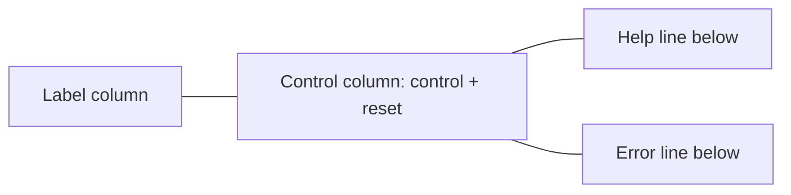

# Form Row

> [!info] Summary
> One setting in a settings or configuration form: a label, one or more controls, a reset button, a help line and an error line. It is a Tesserae pattern with no Material Design 3 counterpart (the controls inside it follow [[Text Field]], [[Switch]] and [[Button]]); its source of truth in code is the configuration app (`tess-ui:apps/shell_config`).

## Purpose

Make a long list of settings scannable and safe to edit: the user finds a label in a fixed column, edits the control next to it, sees at a glance that a value is modified, restores the default with one action and reads what is wrong without leaving the row. The tooltip rule answers owner feedback F8 (hovering anywhere on a feature showed the tooltip of the whole group), F7 (single-line text top aligned) and F6 (content past the frame without a scrollbar) in [[Owner Feedback 2026-11-20]].

## When to use and not

- Use when: a form or settings page lists named values with a default (configuration files, preferences).
- Do not use when: the control stands alone in a dialog (use the control and its own label), the page is a wizard, or the items are list entries ([[List Item]]).

## Anatomy

1. Row container: horizontal, full form width.
2. Label column: label text (`body_medium`, up to 2 lines) and marker lines (`label_small`: "required", "modified by file").
3. Control column: one control per cell, stacked with a 2 dp gap when a setting has several cells (a colour has several channels, a size has width and height).
4. Reset button: an [[Icon Button]] with an undo icon at the end of each control row.
5. Help line (below the controls): the description of the setting.
6. Error line (below the controls): the message about an invalid value.

## Variants

| Variant | Use | Differences |
|---|---|---|
| Switch row | boolean | [[Switch]] as the control |
| Field row | text, number, length | [[Text Field]] |
| Choice row | one of a set | a tonal or outlined [[Button]] that opens a picker |
| Multi-cell row | colour, size, spacing | several controls stacked; a column caption in `label_small` per cell |
| Group header | section | an [[Accordion]] header, not a row |

## States

| State | Visual change | Token values |
|---|---|---|
| Default value (clean) | reset button disabled, no marker | reset content 0.38 |
| Modified (dirty: the value differs from the default or is set in the file) | reset button enabled; the choice button uses the tonal variant | button states of [[Icon Button]] |
| Focus within | help line appears below the controls; the focused control shows its focus ring | [[Focus Ring]] |
| Invalid | error line in `error` role with an error icon, the control outline in `error`, `invalid` set on the control | `error` role |
| Required and missing | marker "required" in `label_small`, `error` | `error` role |
| Disabled | label, control, reset at 0.38; no focus stops | 0.38 |
| Hover | no row-level hover state; each control has its own ([[State Layers]]) | none on the row |

## Tokens used

[[Colour Roles]] (`on_surface`, `on_surface_variant`, `error`), [[Typography]], [[Spacing and Density]]. Control sizes come from the density table; the row adds only the following.

## Sizing and density

The values for control height, row padding, icon button container and text-field padding are the binding table of [[ADR-0002 Desktop density levels and target sizes]]. The rows below are Tesserae choices for this pattern. #needs-verification (design choice)

| Token | default | compact | dense |
|---|---|---|---|
| Control height (switch row, field, choice button) | 40 dp | 32 dp | 28 dp |
| Reset icon button container | 40 dp | 32 dp | 28 dp |
| Reset icon size | 24 dp | 20 dp | 20 dp |
| Text field horizontal padding | 12 dp | 8 dp | 8 dp |
| Label column width | 160 dp | 120 dp | 96 dp |
| Gap between label column and control column | 12 dp | 8 dp | 8 dp |
| Gap between cells in one control column | 2 dp | 2 dp | 2 dp |
| Gap between rows | 8 dp | 4 dp | 2 dp |
| Help and error type | `body_small` | `body_small` | `body_small` |

Row height with one control line equals the control height. The label column width is the same for every row of one form, so that all controls start at the same x.

## Dimensions and defaults

Control height, row padding, icon button container and text-field padding are the binding table of [[ADR-0002 Desktop density levels and target sizes]]; the label column width and the gaps are Tesserae choices #needs-verification-as-design-choice (proposed ADR: form row dimensions by density level). The row has no fill or border of its own.

| Part | Property | Token | Default | Compact | Dense | Source | Settable |
|---|---|---|---|---|---|---|---|
| row (one control line) | height | `density.control_height` | 40 | 32 | 28 | [[Spacing and Density]] | tess-ui: yes (style height); tess-shell: n/a: element absent in tess-shell; tre: yes (height) |
| control | min height | `target.min` | 24 | 24 | 24 | [[Spacing and Density]] | tess-ui: yes (style min_height); tess-shell: n/a: element absent in tess-shell; tre: yes (min_height) |
| reset button | height | `density.icon_button_container` | 40 | 32 | 28 | [[Spacing and Density]] | tess-ui: yes (style height); tess-shell: n/a: element absent in tess-shell; tre: yes (height) |
| label column | min width | - | 160 | 120 | 96 | design choice, proposed ADR (form row dimensions by density); [[Form Row#Sizing and density]] | tess-ui: yes (style min_width); tess-shell: n/a: element absent in tess-shell; tre: yes (min_width) |
| row | padding | `density.row_padding_x` | 0 12 0 12 | 0 8 0 8 | 0 4 0 4 | [[Spacing and Density]] | tess-ui: yes (style padding); tess-shell: n/a: element absent in tess-shell; tre: yes (padding) |
| text field | padding | `density.field_padding_x` | 0 12 0 12 | 0 8 0 8 | 0 8 0 8 | [[Spacing and Density]] | tess-ui: yes (style padding); tess-shell: n/a: element absent in tess-shell; tre: yes (padding) |
| row | margin | - | N/A: the form sets the space between rows (see the gap rows) | N/A: same as default | N/A: same as default | [[Form Row#Sizing and density]] | tess-ui: yes (style margin); tess-shell: n/a: element absent in tess-shell; tre: yes (margin) |
| rows in a form | gap | `space.3`, `space.2`, `space.1` | 8 | 4 | 2 | design choice, proposed ADR (form row dimensions by density); [[Form Row#Sizing and density]] | tess-ui: yes (style gap); tess-shell: n/a: element absent in tess-shell; tre: yes (gap) |
| label column to control column | gap | `space.4`, `space.3`, `space.3` | 12 | 8 | 8 | design choice, proposed ADR (form row dimensions by density); [[Form Row#Sizing and density]] | tess-ui: yes (style gap); tess-shell: n/a: element absent in tess-shell; tre: yes (gap) |
| cells in one control column | gap | `space.1` | 2 | 2 | 2 | design choice, proposed ADR (form row dimensions by density); [[Form Row#Sizing and density]] | tess-ui: yes (style gap); tess-shell: n/a: element absent in tess-shell; tre: yes (gap) |
| row | border width | - | N/A: the row draws no border; each control draws its own ([[Text Field]]) | N/A: same as default | N/A: same as default | [[Form Row#Anatomy]] | tess-ui: yes (style border_width); tess-shell: n/a: element absent in tess-shell; tre: yes (border_width) |
| control (invalid) | border color | `error` | `error` | `error` | `error` | [[Form Row#States]] (the control outline turns `error`) | tess-ui: yes (style border_color); tess-shell: n/a: element absent in tess-shell; tre: yes (border_color) |
| row | corner radius | - | N/A: the row has no fill or outline; corners belong to the controls ([[Text Field]], [[Button]]) | N/A: same as default | N/A: same as default | [[Shape]] | tess-ui: yes (style corner_radius); tess-shell: n/a: element absent in tess-shell; tre: yes (corner_radius) |
| label | font | `body_medium` | 14/20/400/0.25 | 14/20/400/0.25 | 14/20/400/0.25 | [[Typography]] | tess-ui: via type role in the theme; tess-shell: n/a: element absent in tess-shell; tre: yes (font_size, font_weight, line_height) |
| marker lines, column caption | font | `label_small` | 11/16/500/0.5 | 11/16/500/0.5 | 11/16/500/0.5 | [[Typography]] | tess-ui: via type role in the theme; tess-shell: n/a: element absent in tess-shell; tre: yes (font_size, font_weight, line_height) |
| help line, error line | font | `body_small` | 12/16/400/0.4 | 12/16/400/0.4 | 12/16/400/0.4 | [[Typography]] | tess-ui: via type role in the theme; tess-shell: n/a: element absent in tess-shell; tre: yes (font_size, font_weight, line_height) |
| reset button | icon size | `density.icon_button_icon` | 24 | 20 | 20 | [[Spacing and Density]] | tess-ui: via widget icon size; tess-shell: n/a: element absent in tess-shell; tre: yes (width, height of the svg node) |
| row | elevation | `elevation.level_0` | 0 | 0 | 0 | [[Elevation]] | tess-ui: yes (style elevation); tess-shell: n/a: element absent in tess-shell; tre: yes (shadows) |

## Layout and overflow

- Alignment grid: label column at x = row padding; control column at x = label column width + gap; the reset button is at the right end of the control column and its width is reserved in both clean and modified states, so a control never moves when the state changes.
- The label's first line is vertically centred on the first control line (centre to centre within 0.5 dp). Marker lines follow below the label.
- The label wraps at most 2 lines and then ends with an ellipsis; its width never exceeds the label column.
- The control column has a minimum width of 0 and takes the remaining width. A text field fills it.
- Narrow forms: when the form content width is below 400 dp, the label sits above the control (stacked), the label column becomes the full width. #needs-verification (design choice).
- Single-line text fields: the text is left aligned and centred vertically by construction; text line height is centred in the control height at every density (F7). Text padding must not be tuned per font.
- The help line and error line sit below the controls and span the control column; opening the help line does not move the focused control.
- The form sits in a scroll container; it shows a vertical bar when rows exceed the height, and a horizontal bar if the minimum row width exceeds the viewport ([[Scrollbar and Scroll Container]], F6).

## Behaviour

- Pointer: each control acts on its own; the label is not a control (a click on the label focuses the first control #needs-verification); the reset button restores the default value and the row becomes clean.
- Keyboard: Tab order is the visual order: first control, further cells, reset button (when enabled), then the next row. The label is never a Tab stop. Shift plus Tab reverses. Enter in a text field commits it. A disabled reset is not a stop. After the reset button is activated, the focus moves to the row's first control (the button becomes disabled, and a disabled button cannot keep focus).
- Touch: containers use 48 dp controls in touch contexts.

## Tooltip and overlay behaviour

Per [[ADR-0004 Tooltip rule]] and F8:

- The tooltip belongs to the label element (the label text together with its marker lines). It shows the description of the setting after a 500 ms hover. The label is not focusable, so keyboard users get the same description from the help line that appears on focus within the row and from the control's accessible description.
- The reset button carries its own tooltip with its accessible name "Reset {label} to its default".
- The row container, the control column, a cell, a group container and the form carry no tooltip. A switch or field has no tooltip of its own; its description is its accessible description.
- Only one tooltip is visible at a time; leaving the label dismisses it; a tooltip is never the only way to read the description (the help line shows on focus).

## Motion

The help and error lines appear without animation (0 ms) so the focused control does not move; the reset button state change has no animation; reduced motion changes nothing ([[Motion]]).

## Accessibility

- The control's accessible name is the label text; its description is the help text. The label is not a separate focus stop.
- The reset button name is "Reset {label} to its default".
- The error line is a live region (polite): the message is announced once when it appears; the control has `invalid` set and the description references the error.
- Required and modified are exposed as properties (`required`, a "modified" token in the description) and not by colour alone: markers are text.
- Contrast: label and controls 4.5 to 1; the error text 4.5 to 1 on the surface in light and dark ([[14 Accessibility Basics]]).

## Dark and light

Roles only ([[Theme Following the System]]).

## Defaults

Label column per density, help line on focus within, reset button always present (disabled when clean), stacked layout below 400 dp.

## Acceptance criteria

- [ ] AC-FRM-01: Geometry check. In a form of 12 rows, the control column left edge is identical (0.5 dp) for every row, and the label column width equals the table value for the density.
- [ ] AC-FRM-02: Geometry check. For a single-control row, row height equals the control height (40, 32, 28 dp); the label first line centre is within 0.5 dp of the control centre.
- [ ] AC-FRM-03: Geometry check. A label of 200 characters wraps to at most 2 lines, ends with an ellipsis and its right edge does not exceed the label column.
- [ ] AC-FRM-04: Scripted input (F8). Hovering the label for 500 ms shows one tooltip with the description; hovering the switch, the control, the gap between them and the row background for 2 s shows none; hovering the reset button shows only its own tooltip; two tooltips are never visible at once.
- [ ] AC-FRM-05: AT tree assertion and static check. No node of role group, row, cell or form carries a tooltip; the only tooltip-bearing nodes of a row are the label and the reset button.
- [ ] AC-FRM-06: Scripted input. The reset button is enabled if and only if the value differs from the default; its x position and width are identical in both states; activating it restores the default and moves focus to the first control of the row.
- [ ] AC-FRM-07: AT tree assertion. The reset button name is "Reset {label} to its default"; a disabled reset is not in the Tab order.
- [ ] AC-FRM-08: Scripted input. Tab order of a two-row form is: row 1 control, row 1 reset (if enabled), row 2 control; Shift plus Tab reverses it; the label is never focused.
- [ ] AC-FRM-09 (pixel check and AT tree assertion): Pixel and AT check. An invalid value shows an error line in `error` role with an icon below the control column, the control outline in `error`, `invalid` true on the control, and a polite live announcement of the message once.
- [ ] AC-FRM-10: Pixel check. A required and missing row shows the text "required" under the label in `label_small`, `error` role.
- [ ] AC-FRM-11: Geometry check (F7). In a single-line field at all densities the text line box centre is within 0.5 dp of the field centre and the text left edge is the horizontal padding (12, 8, 8 dp) from the field edge.
- [ ] AC-FRM-12: Geometry check. When the help line appears on focus, the y position of the focused control does not change and the help line lies below the control column.
- [ ] AC-FRM-13: Pixel check. A disabled row shows label, control and reset at opacity 0.38 and has no focus stops.
- [ ] AC-FRM-14: Geometry check. At a form content width of 360 dp the label sits above the control and no row has horizontal overflow; at 480 dp the label sits beside it.
- [ ] AC-FRM-15: Geometry check (F6). A form whose rows exceed the viewport height shows a vertical bar; a form whose minimum row width exceeds the viewport width shows a horizontal bar; neither shows otherwise.
- [ ] AC-FRM-16: Contrast script. Label, control text and error text reach 4.5 to 1 against the surface in the light and dark baseline schemes.

## Status in code

| Project | Path | Status per spec |
|---|---|---|
| tess-ui (config app) | `tess-ui:apps/shell_config/src/tess_shell_config/Views/Main_View.tdl` (`form_item`, `row`, `label_box`, `cells`, `cell`, `reset_button`, `row_error`, `doc_line`, `group_header`), `form.py`, `widgets.py` | partly meets. Row Gap 8, label box `Width: 120`, label `body_medium` with `Max_Lines: 2`, marker lines (`required`, markers) in `label_small`, cells column `Flex: expand_horizontal` with `Min_Width: 0`, Gap 2 between cells, reset is an `IconButton` `Size: xs` (32 px) with `Label: Reset <label> to its default` (its tooltip) and is disabled when the key is absent, `row_error` text in `error` with `Live: polite`, `doc_line` only while the row has focus within, rows 2 px apart. Doc tooltip is on the label box (label and marker texts only): meets AC-FRM-04, 05 for the label; no tooltip on row, cells or group (PR #328). Against `compact`: label width 120 meets, control 32 meets, padding 8 meets; the error line has no icon (AC-FRM-09 fails); reset focus moves nowhere defined (AC-FRM-06 not verified); the narrow stacked layout is absent (AC-FRM-14 fails); form scroll is a vertical `ScrollView` only (AC-FRM-15 fails when min width exceeds the viewport) |
| tess-ui (config app text fields) | `Main_Stylesheet.tdl`, TextInput | partly meets AC-FRM-11. Single-line field is 32 px with 7 px top and bottom and 8 px left and right padding (PR #329); the engine text_input has no vertical-align property, so centring is by padding and not by construction (depends on the font line height) |
| tess-shell | none | absent (no form pattern; the shell has no settings forms) |
| tre | `tre:docs/reference/node.md` (`invalid`, `description`, `required`-type flags) | not applicable (engine flags only; no field background, label or error visual) |

Evidence: F6, F7, F8 and the config-app demo in [[Owner Feedback 2026-11-20]]; the doc tooltip on the whole row (F8) was the demo defect and PR #328 moved it to the label box.

## Deviations from Material Design 3

| Deviation | Reason | ADR |
|---|---|---|
| A settings row pattern that MD3 lacks | configuration tools are lists of named values | [[ADR-0001 MD3 role names are the specification vocabulary]] |
| Label beside the control, not a floating or in-field label | scan by label column, fixed grid | [[ADR-0002 Desktop density levels and target sizes]] |
| Persistent reset button | defaults matter in config files | none; design choice |

## Sources

- MD3 text fields and switch are the control references ([[Text Field]], [[Switch]]); no MD3 form row exists (Material Web repository listing, https://github.com/material-components/material-web, 2026-11-21). #needs-verification (m3.material.io guidance on forms).
- Tooltip rule: [[ADR-0004 Tooltip rule]]; the owner's evidence: [[Owner Feedback 2026-11-20]].
- Code (origin/main c7117cb): `tess-ui:apps/shell_config/src/tess_shell_config/Views/Main_View.tdl`, `Main_Stylesheet.tdl`; `tess-ui:src/tess_ui/composed.py` (`_wire_tooltips`).
