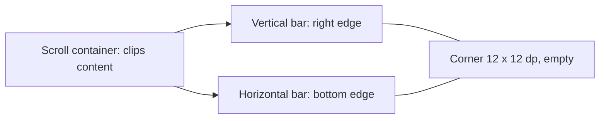

# Scrollbar and Scroll Container

> [!info] Summary
> A scroll container clips its content and moves it along one or both axes; its scrollbar shows where the viewport sits in the content and lets the pointer drag it. Material Design 3 has no scrollbar component (see Sources), so this note is a Tesserae specification that implements [[ADR-0003 Scrollbar rule]] completely. Source of truth in code: the last section.

## Purpose

Show the user that content continues past the visual frame and give a pointer, a keyboard and a wheel the same, predictable way to reach it. Owner feedback F6 ("no horizontal scroll bars though every panel has content past the visual frame", [[Owner Feedback 2026-11-20]]) is the origin of the rule that every axis with overflow shows its own scrollbar.

## When to use and not

- Use when: a panel, pane, list, tree, form or text area can hold more content than its frame on one or both axes.
- Do not use when: content is fitted by wrapping or by ellipsis (see [[10 Layout Overflow and Scrolling]]); prefer wrapping or ellipsis first, a scrollbar is the fallback and never the cure for a label that could truncate.
- Use a paged or snapped container (Carousel, Tabs) when items are discrete; snap is described below.

## Anatomy

1. Scroll container: a clipping box with a viewport, content and a scroll offset per axis.
2. Thumb: the painted bar whose length is proportional to viewport divided by content.
3. Track: the invisible lane the thumb moves in; track-less by default (nothing painted).
4. Hit area: the pointer-sensitive strip around the thumb and along the lane.
5. Gutter: space reserved at the end edge of an overflowing axis so that content does not sit under the thumb.
6. Corner: the square where two bars would meet; it stays empty.

## Variants

| Variant | Use | Differences |
|---|---|---|
| Vertical | default for lists, forms, trees | bar on the end side (right in left-to-right) |
| Horizontal | wide trees, tables, code, wide forms | bar on the bottom edge |
| Both axes | trees with long labels, canvases, tables | two thumbs, corner square, see AC-SCB-04 |
| Virtualised | long lists that build only visible rows | same bar; the thumb length uses the estimated total extent; the same keys apply, see Behaviour |
| Snapping | carousels, tab strips, pickers | the offset settles on a snap point, see Motion |

## States

The thumb colour role is `on_surface_variant` ([[Colour Roles]]). The opacities are Tesserae design choices accepted by [[ADR-0012 Scrollbar thumb opacity and hit area exception]] (amending [[ADR-0003 Scrollbar rule]]); the state-layer percentages of [[ADR-0009 State layer percentages]] do not apply, because a thumb is a painted indicator and not a pressable surface. No MD3 value exists for a scrollbar thumb; the contrast check of AC-SCB-09 is the basis of the rest value.

| State | Visual change | Token values |
|---|---|---|
| Rest | thumb visible whenever the axis overflows | `scrollbar.thumb.opacity.rest` 0.70 |
| Hover (pointer inside the hit area) | thumb darker, same size | `scrollbar.thumb.opacity.hover` 0.80 |
| Dragged | thumb at full opacity | `scrollbar.thumb.opacity.drag` 1.00 |
| Focus | none on the thumb; the container shows the [[Focus Ring]] only if it is itself focusable and has no focusable descendant | focus ring tokens |
| Disabled | not applicable; a container that cannot scroll shows no thumb | none |
| No overflow on an axis | no thumb for that axis, no gutter for that axis | none |
| Empty content | no thumb | none |

## Tokens used

Colour from [[Colour Roles]], radius from [[Shape]], density and targets from [[Spacing and Density]]. The scrollbar tokens are defined here once; other notes link to this table.

| Token | Value | Notes |
|---|---|---|
| `scrollbar.thumb.thickness` | 8 dp | painted size across the axis; #needs-verification (design choice) |
| `scrollbar.hit.thickness` | 12 dp | pointer-sensitive size across the axis, centred on the thumb (8 dp thumb plus 2 dp margin each side) |
| `scrollbar.margin` | 2 dp | between thumb and container edge, and between thumb end and lane end |
| `scrollbar.thumb.min_length` | 32 dp | along the axis |
| `scrollbar.thumb.radius` | `full` (4 dp at 8 dp thickness) | [[Shape]] |
| `scrollbar.thumb.color` | role `on_surface_variant` | |
| `scrollbar.thumb.opacity.rest` / `.hover` / `.drag` | 0.70 / 0.80 / 1.00 | accepted by [[ADR-0012 Scrollbar thumb opacity and hit area exception]]; contrast of the rest value: AC-SCB-09 |
| `scrollbar.track.color` | none (transparent) | a track-less thumb is allowed by [[ADR-0003 Scrollbar rule]] |
| `scrollbar.gutter` | 12 dp (equals `scrollbar.hit.thickness`) | reserved at the end edge of an axis that overflows; #needs-verification (design choice) |
| `scrollbar.corner` | 12 dp square, empty | where both axes overflow |
| `scroll.key.line` | 40 dp | arrow keys |
| `scroll.key.page` | viewport extent minus 10 percent | Page Up, Page Down, track click |
| `scroll.wheel.notch` | 40 dp per notch | #needs-verification (design choice); the engine moves 20 dp per notch today |
| `scroll.snap.settle` / `.duration` | 120 ms / 200 ms | engine values, kept |

The values do not change with density: the bar is a pointer target of its own and the 8 dp thumb with 12 dp hit area is the same at `default`, `compact` and `dense` ([[Spacing and Density]]). Touch contexts (ADR-0002, 48 dp targets) set `scrollbar.hit.thickness` to 48 dp.

## Properties a project can set

Normative. [[ADR-0020 The engine never blocks the design]] applies: every row is settable from the project layer (Python property or declarative hook such as a stylesheet rule), never by per-frame Python and never by editing engine code. The default is the specification value; a project that sets nothing gets the defaults. Any property can be set for the whole project and overridden on a single scroll container (the last row). Names equal the tokens of the table above; the tre property in the Name column is the engine side of the hook. Tre status is stated per row: "exists in tre 0.6.11 (both views)" is a property of a `both` scroll view (PR 326); "hardcoded in tre" is a constant the engine fixes and an engine request ([[UXREQ-001 Two-axis scroll view with the specified scrollbar]], P1 of the tre audit); "new" does not exist in tre today. The `virtual_list` ignores `scrollbar_*` today.

| Property | Name | Default | Unit | Meaning |
|---|---|---|---|---|
| Thumb shape | `scrollbar.thumb.shape` (tre `scrollbar_shape`, new) | `pill` | `pill`, `rounded`, `rect` | outline of the thumb; `pill` has full radius |
| Thumb radius | `scrollbar.thumb.radius` (tre `scrollbar_radius`, hardcoded in tre at 2 px, request UXREQ-001) | `full` (4 dp at 8 dp) | dp or `full` | corner radius when the shape is `rounded` |
| Thumb thickness | `scrollbar.thumb.thickness` (tre `scrollbar_width`, exists in tre 0.6.11 (both views); one-axis views keep 4 px until set) | 8 | dp | painted size across the axis |
| Minimum thumb length | `scrollbar.thumb.min_length` (tre `scrollbar_min_length`, exists in tre 0.6.11 (both views)) | 32 | dp | lower bound of the thumb length along the axis |
| Hit area | `scrollbar.hit.thickness` (tre `scrollbar_hit_width`, exists in tre 0.6.11 (both views); one-axis views keep slop 6) | 12 | dp | pointer-sensitive size across the axis, centred on the thumb |
| Margin or inset | `scrollbar.margin` (tre `scrollbar_margin`, exists in tre 0.6.11 (both views)) | 2 | dp | space between thumb and container edge and between thumb end and lane end |
| Thumb colour, rest | `scrollbar.thumb.color` (tre `scrollbar_fill`, exists in tre 0.6.11 (both views); one-axis views use alpha 0x8C) | role `on_surface_variant` | colour role or colour | colour of the thumb at rest |
| Thumb colour, hover | `scrollbar.thumb.color.hover` (tre per-state colours, hardcoded in tre, request: `scrollbar_fill_hover`) | same role as rest | colour role or colour | colour under the pointer |
| Thumb colour, pressed or drag | `scrollbar.thumb.color.drag` (tre per-state colours, hardcoded in tre, request: `scrollbar_fill_drag`) | same role as rest | colour role or colour | colour while dragged |
| Track colour | `scrollbar.track.color` (tre track fill, hardcoded in tre, request: `scrollbar_track`) | none (transparent) | colour role or none | colour of the lane |
| Track visibility | `scrollbar.track.visible` (tre track fill, hardcoded in tre, request: `scrollbar_track`) | off | boolean | paints the lane when on |
| Opacity, rest | `scrollbar.thumb.opacity.rest` (tre `scrollbar_opacity`, exists in tre 0.6.11 (both views)) | 0.70 | 0 to 1 | alpha of the rest state |
| Opacity, hover | `scrollbar.thumb.opacity.hover` (tre `scrollbar_opacity_hover`, exists in tre 0.6.11 (both views)) | 0.80 | 0 to 1 | alpha under the pointer |
| Opacity, drag | `scrollbar.thumb.opacity.drag` (tre `scrollbar_opacity_drag`, exists in tre 0.6.11 (both views)) | 1.00 | 0 to 1 | alpha while dragged |
| Wheel notch | `scroll.wheel.notch` (tre `wheel_notch`, hardcoded in tre: 40 on a both view, 20 on one-axis views, request) | 40 | dp | distance per wheel notch |
| Key line step | `scroll.key.line` (tre `key_line`, hardcoded in tre, request) | 40 | dp | Up, Down, Left, Right |
| Key page step | `scroll.key.page` (tre `page_fraction`, hardcoded in tre: 0.9 on a both view, a full viewport on one-axis views, request) | viewport extent minus 10 percent | fraction of the viewport | Page Up, Page Down, lane click |
| Smooth-scroll speed | `scroll.smooth.duration` (tre `scroll_smooth_ms`, hardcoded in tre, request) | 0 (jump) | ms | duration of an eased wheel or key scroll; 0 jumps |
| Smooth-scroll curve | `scroll.smooth.easing` (tre `scroll_smooth_easing`, new) | `easing-standard` | cubic-bezier | curve of the eased scroll when the duration is above 0 |
| Snap timing | `scroll.snap.settle` / `.duration` (tre `snap_settle_ms`, `snap_duration_ms`, `snap_easing`, proposed, hardcoded 120 and 200 ms) | 120 / 200 | ms | settle delay and animation of snap |
| Thumb state fade | `scrollbar.fade.duration` (tre `scrollbar_fade_duration`, hardcoded in tre: 100 ms and bezier(0.2, 0, 0, 1), request) | 100 | ms | opacity change between states, and fade in or out when the policy is `auto-hide` |
| Auto-hide delay | `scrollbar.autohide.delay` (tre `scrollbar_autohide_delay`, new) | 1000 (used only by `auto-hide`) | ms | idle time before the bar fades out |
| Hover delay | `scrollbar.hover.delay` (tre `scrollbar_hover_delay`, new) | 0 | ms | time the pointer rests in the hit area before the hover state |
| Lane repeat | `scrollbar.lane.repeat.delay` / `.interval` (new) | 400 / 100 | ms | first delay and repeat of a pressed lane click |
| Gutter reserved | `scrollbar.gutter.reserve` (tre `scrollbar_gutter_reserve`, new) | on | boolean | reserves the gutter on an overflowing axis; off lets the thumb overlay content |
| Gutter width | `scrollbar.gutter` (tre `scrollbar_gutter`, exists in tre 0.6.11 (both views)) | 12 | dp | reserved space, equal to the hit thickness unless set |
| Corner | `scrollbar.corner` (tre `scrollbar_corner`, exists in tre 0.6.11 (both views)) | 12 | dp (square) | empty square where both axes overflow |
| Vertical bar side | `scrollbar.side.vertical` (tre `scrollbar_side_v`, hardcoded in tre, request) | `end` (right in left-to-right) | `start`, `end` | `end` follows the writing direction |
| Horizontal bar side | `scrollbar.side.horizontal` (tre `scrollbar_side_h`, hardcoded in tre, request) | `bottom` | `top`, `bottom` | edge of the horizontal bar |
| Right-to-left | `scrollbar.side.rtl` (tre `scrollbar_rtl`, new) | `follow` | `follow`, `ltr`, `rtl` | `follow` mirrors the vertical bar and the origin of the horizontal offset with the layout direction |
| Show policy | `scrollbar.visibility` (tre `scrollbar_visibility`, hardcoded in tre, request) | `overflow` | `always`, `overflow`, `auto-hide`, `never` | `always` draws a disabled bar without overflow; `overflow` follows F6; `never` hides the bar but keeps the wheel and keys |
| Arrow buttons | `scrollbar.arrows` (tre `scrollbar_arrows`, hardcoded in tre, request) | off | boolean | a button at each end of the lane that scrolls one key line step |
| Arrow button size | `scrollbar.arrow.size` (tre `scrollbar_arrow_size`, hardcoded in tre, request) | 12 | dp | length of an arrow button along the axis |
| Lane click | `scrollbar.lane.click` (tre `scrollbar_lane_click`, hardcoded in tre, request) | `page` | `page`, `jump` | `page` scrolls one page toward the press; `jump` moves the thumb centre to the press point |
| Per-element override | style key or node property of the same name on one scroll container | none | any row above | the value on the container replaces the project default for that container only |

Raising `scrollbar.hit.thickness` or switching the policy never removes the keyboard and wheel route of AC-SCB-21.

## Sizing and density

- Thumb 8 dp across the axis, hit strip 12 dp, minimum thumb length 32 dp (a 24 dp minimum target length is met on the long side).
- The 12 dp hit thickness is below the 24 dp minimum pointer target of WCAG 2.2 SC 2.5.8. The note relies on the equivalent-control exception of that criterion, accepted by [[ADR-0012 Scrollbar thumb opacity and hit area exception]]: every scroll container offers keyboard scrolling (arrows, Page Up, Page Down, Home, End) and wheel scrolling, so the thumb is never the only way to scroll. A container that cannot be scrolled by keyboard does not qualify and must use a 24 dp hit thickness (AC-SCB-21).
- Thumb length along an axis = max(`scrollbar.thumb.min_length`, lane x viewport / content), where lane = viewport extent - 2 x `scrollbar.margin` (minus `scrollbar.corner` when the other axis also overflows).

## Dimensions and defaults

The values are those of the Tokens table and are the same at `default`, `compact` and `dense` (the bar is a pointer target of its own); a touch context (48 dp targets) sets the hit thickness to 48. The thumb is filled with role `on_surface_variant` at opacity 0.70 at rest, 0.80 under the pointer and 1.00 while dragged ([[ADR-0012 Scrollbar thumb opacity and hit area exception]]). Thumb length along the axis is computed, `max(32, lane x viewport / content)`. In tre 0.6.11 the Settable cells hold for a `both` scroll view; a one-axis view keeps the legacy values until the property is set.

| Part | Property | Token | Default | Compact | Dense | Source | Settable |
|---|---|---|---|---|---|---|---|
| container (viewport) | height | - | N/A: the owner sets the viewport size; content beyond it scrolls | N/A: same as default | N/A: same as default | [[Spacing and Density]] | tess-ui: yes (style height); tess-shell: yes (Height); tre: yes (height) |
| container (viewport) | padding | `space.0` | 0 0 0 0 | 0 0 0 0 | 0 0 0 0 | [[Spacing and Density]] | tess-ui: yes (style padding, applied to the content box); tess-shell: via Padding on the content child Box; tre: via padding on the content child |
| container (viewport) | margin | - | N/A: the parent container sets the outer space | N/A: same as default | N/A: same as default | [[Spacing and Density]] | tess-ui: yes (style margin); tess-shell: yes (Margin); tre: yes (margin) |
| container (viewport) | gap | - | N/A: the container has one content child; gaps belong to that child | N/A: same as default | N/A: same as default | [[Spacing and Density]] | tess-ui: yes (style gap, applied to the content box); tess-shell: n/a: one content child and no Spacing key on the ScrollBox; tre: n/a: the scroll view holds one content child |
| container (viewport) | border width | - | N/A: the container draws no border; paint is the content's or a parent's | N/A: same as default | N/A: same as default | [[Spacing and Density]] | tess-ui: yes (style border_width); tess-shell: n/a: the ScrollBox has no border key, a parent Box draws it; tre: yes (stroke_width) |
| container (viewport) | border color | - | N/A: the container draws no border; paint is the content's or a parent's | N/A: same as default | N/A: same as default | [[Spacing and Density]] | tess-ui: yes (style border_color); tess-shell: n/a: the ScrollBox has no border key, a parent Box draws it; tre: yes (stroke_color) |
| container (viewport) | corner radius | - | N/A: the container clips to its own bounds and the rounding of a parent | N/A: same as default | N/A: same as default | [[Shape]] | tess-ui: yes (style corner_radius); tess-shell: n/a: the ScrollBox has no radius key, a parent Box rounds; tre: yes (corner_radius, the content clips to it) |
| container (viewport) | font | - | N/A: the container draws no text | N/A: same as default | N/A: same as default | [[Typography]] | tess-ui: n/a: a ScrollView draws no text; tess-shell: n/a: the block draws no text; tre: n/a: the scroll view draws no text |
| container (viewport) | icon size | - | N/A: the container draws no icon | N/A: same as default | N/A: same as default | [[Iconography]] | tess-ui: n/a: a ScrollView draws no icon; tess-shell: n/a: the block draws no icon; tre: n/a: the scroll view draws no icon |
| container (viewport) | elevation | `elevation.level0` | 0 | 0 | 0 | [[Elevation]] | tess-ui: yes (style elevation); tess-shell: yes (Elevation percentage); tre: yes (shadows) |
| thumb, across the axis | min width | `scrollbar.thumb.thickness` | 8 | 8 | 8 | [[ADR-0003 Scrollbar rule]], [[ADR-0012 Scrollbar thumb opacity and hit area exception]] | tess-ui: no hook; tess-shell: no hook; tre: yes (scrollbar_width, exists in tre 0.6.11 on both views, legacy 4 on one-axis views) |
| thumb, along the axis | min height | `scrollbar.thumb.min_length` | 32 | 32 | 32 | [[ADR-0003 Scrollbar rule]], [[ADR-0012 Scrollbar thumb opacity and hit area exception]] | tess-ui: no hook; tess-shell: no hook; tre: yes (scrollbar_min_length, exists in tre 0.6.11 on both views) |
| thumb | margin | `scrollbar.margin` | 2 | 2 | 2 | [[ADR-0003 Scrollbar rule]], [[ADR-0012 Scrollbar thumb opacity and hit area exception]] | tess-ui: no hook; tess-shell: no hook; tre: yes (scrollbar_margin, exists in tre 0.6.11 on both views) |
| thumb | corner radius | `scrollbar.thumb.radius` | 9999 | 9999 | 9999 | [[Shape]] | tess-ui: no hook; tess-shell: no hook; tre: hardcoded in tre (SCROLLBAR_THUMB_RADIUS 2.0, proposed scrollbar_radius) |
| thumb | border width | - | N/A: the thumb is a filled bar without a border | N/A: same as default | N/A: same as default | [[ADR-0003 Scrollbar rule]], [[ADR-0012 Scrollbar thumb opacity and hit area exception]] | tess-ui: n/a: the thumb has no border; tess-shell: n/a: the thumb has no border; tre: n/a: the thumb has no border |
| thumb | border color | - | N/A: the thumb has no border; its fill is role `on_surface_variant` at opacity 0.70 rest, 0.80 hover, 1.00 drag | N/A: same as default | N/A: same as default | [[ADR-0012 Scrollbar thumb opacity and hit area exception]] | tess-ui: yes (scrollbar_fill, role outline today), opacities no hook; tess-shell: no hook; tre: yes (scrollbar_fill, scrollbar_opacity, scrollbar_opacity_hover, scrollbar_opacity_drag, exist in tre 0.6.11 on both views), per-state colours hardcoded in tre (proposed scrollbar_fill_hover, scrollbar_fill_drag) |
| thumb | padding | - | N/A: the thumb has no content; its inset is the margin row | N/A: same as default | N/A: same as default | [[ADR-0003 Scrollbar rule]], [[ADR-0012 Scrollbar thumb opacity and hit area exception]] | tess-ui: n/a: the thumb has no content; tess-shell: n/a: the thumb has no content; tre: n/a: the thumb has no content |
| thumb | elevation | `elevation.level0` | 0 | 0 | 0 | [[Elevation]] | tess-ui: n/a: the thumb casts no shadow; tess-shell: n/a: the thumb casts no shadow; tre: n/a: the thumb casts no shadow |
| hit area | min width | `scrollbar.hit.thickness` | 12 | 12 | 12 | [[ADR-0012 Scrollbar thumb opacity and hit area exception]] | tess-ui: no hook; tess-shell: no hook; tre: yes (scrollbar_hit_width, exists in tre 0.6.11 on both views, legacy slop 6 on one-axis views) |
| gutter | padding | `scrollbar.gutter` | 0 12 0 0 | 0 12 0 0 | 0 12 0 0 | [[ADR-0003 Scrollbar rule]], [[ADR-0012 Scrollbar thumb opacity and hit area exception]] | tess-ui: no hook; tess-shell: no hook; tre: yes (scrollbar_gutter, exists in tre 0.6.11 on both views) |
| corner | min width | `scrollbar.corner` | 12 | 12 | 12 | [[ADR-0003 Scrollbar rule]], [[ADR-0012 Scrollbar thumb opacity and hit area exception]] | tess-ui: no hook; tess-shell: no hook; tre: yes (scrollbar_corner, exists in tre 0.6.11 on both views) |
| corner | min height | `scrollbar.corner` | 12 | 12 | 12 | [[ADR-0003 Scrollbar rule]], [[ADR-0012 Scrollbar thumb opacity and hit area exception]] | tess-ui: no hook; tess-shell: no hook; tre: yes (scrollbar_corner, exists in tre 0.6.11 on both views) |
| track | border color | - | N/A: the track is transparent and paints nothing | N/A: same as default | N/A: same as default | [[ADR-0003 Scrollbar rule]] | tess-ui: no hook; tess-shell: no hook; tre: hardcoded in tre (no track fill, proposed scrollbar_track) |

## Layout and overflow

- A container shows the bar of an axis if and only if content extent exceeds viewport extent on that axis (F6). Overflow is measured, not assumed from the content type.
- Content stays inside the frame: the container clips to its bounds and corner radius; nothing is drawn past the frame.
- Both axes: two thumbs. The vertical lane ends `scrollbar.corner` above the bottom edge and the horizontal lane ends `scrollbar.corner` left of the right edge, so the two thumbs never overlap. The corner square is empty.
- The gutter: when an axis overflows, content end padding on the cross axis is at least `scrollbar.gutter`, so that a label or control is not covered by the thumb. A vertical thumb sits in the right gutter, a horizontal one in the bottom gutter.
- Ellipsis and wrapping come first: a label that can truncate truncates (see [[Tree Node]], [[List Item]]); only content that cannot shrink (a long unbroken code line, a wide table) makes a horizontal bar.
- A scroll container nested in another passes on the wheel and keys it cannot use (scroll chaining).

## Behaviour

- Pointer:
  - Wheel: one notch moves `scroll.wheel.notch`; vertical wheel moves the vertical axis; Shift plus wheel, or a sideways wheel or trackpad, moves the horizontal axis. Over a container that cannot move that way the wheel goes to the container outside it.
  - Drag: pressing inside the hit area of the thumb grabs it; the offset follows the pointer linearly, offset = start offset + pointer delta x (content - viewport) / (lane - thumb length); the drag continues while the pointer is outside the gutter and ends on release.
  - Click on the lane outside the thumb: scrolls by `scroll.key.page` toward the click, repeating while pressed with a 400 ms first delay and a 100 ms repeat #needs-verification (design choice).
  - Hover over the hit area switches the thumb to the hover opacity.
- Keyboard (any container that has focus or contains the focused node; a container with overflow and no focusable descendant is itself a Tab stop):

| Key | Vertical axis | Horizontal axis |
|---|---|---|
| Up, Down | one line, 40 dp | none |
| Left, Right | none | one line, 40 dp |
| Page Up, Page Down | viewport extent minus 10 percent | none |
| Home, End | offset 0, offset max | offset 0, offset max when the container is horizontal only |
| Shift plus Page Up, Page Down | none | viewport extent minus 10 percent |

  Keys the focused node uses itself are not scrolled (a text input keeps its arrows and Home, End). Ctrl, Alt and Meta combinations are shortcuts and never scroll. Keyboard scrolls jump, they do not ease.
- Virtualised lists and trees: the same keys, and moving the focus to a row scrolls it into view by the least distance that shows it; Home and End move focus and offset to the first and last row. The thumb is draggable. A virtualised container whose rows are not scrollable by key violates [[ADR-0003 Scrollbar rule]].
- Focus: moving focus into a child scrolls it into view by the least distance that shows it, with `scrollbar.gutter` and the [[Focus Ring]] outset (3 dp ring plus 2 dp offset) inside the viewport.
- Touch: drag pans the content with fling; the bar is shown while content overflows and is not the touch handle.
- Snap (`scroll_snap` start, center or end): after the last input the offset settles on the nearest snap point within `scroll.snap.settle` and animates `scroll.snap.duration`; programmatic offsets are not snapped; the default is no snap. Snap acts along one axis: tre settles a view on the items along its one orientation (the tre audit records it as vertical-only) and has no snap on a two-axis container; a container that needs snap on both axes needs a tre hook (see Status in code).

## Tooltip and overlay behaviour

The scrollbar has no tooltip. A scroll offset indicator tooltip ("page 3 of 9") is not specified. A scrolling ancestor dismisses any open tooltip inside it ([[ADR-0004 Tooltip rule]]).

## Motion

- Wheel and key scrolls jump; thumb opacity changes use `short2` 100 ms ([[Motion]]); no fade in or out of the bar (no auto-hide).
- Snap settles over 200 ms with `easing-standard` cubic-bezier(0.2, 0, 0, 1); under reduced motion the settle is 0 ms.

## Accessibility

- A container with overflow and no focusable descendant is a Tab stop with an accessible name (its pane label) so that arrows scroll it ([[14 Accessibility Basics]]).
- Assistive technology can request that a node scroll into view and the container honours it.
- The thumb is not a separate focus stop and is hidden from the accessibility tree; its position equals the container offset. Whether to expose a `scrollbar` role with value is #needs-verification.
- Thumb contrast: the thumb at rest needs 3 to 1 against the container colour for WCAG 2.2 SC 1.4.11 non-text contrast when it is the only cue for hidden content. Over `surface` (`on_surface_variant`): at 0.38 the ratio is 2.57 to 1 in dark and 1.94 to 1 in light; at 0.60 it is 4.61 and 3.11 but only 2.76 over `surface_dim` in light; at 0.70 it is 5.85 and 3.96, and the minimum over every surface role in all six schemes is 3.40 (light, `surface_dim`). The smallest opacity that reaches 3.0 on every container is 0.65 (3.06); [[ADR-0012 Scrollbar thumb opacity and hit area exception]] sets 0.70 for margin. `tools/contrast_check.py` computes these figures.
- Target size: see Sizing; the 12 dp hit thickness relies on the equivalent-control exception of WCAG 2.2 SC 2.5.8 (ADR-0012), tested by AC-SCB-21.

## Dark and light

Colours are roles and follow the scheme ([[Theme Following the System]]). No hex value is fixed in the container; only the opacity tokens are.

## Defaults

Both axes enabled, thumb visible whenever overflow exists, no auto-hide, no track, no snap, vertical wheel to vertical axis, hit 12 dp, gutter 12 dp.

## Acceptance criteria

- [ ] AC-SCB-01: Token test. The scrollbar token set exists with `scrollbar.thumb.thickness` 8, `scrollbar.hit.thickness` 12, `scrollbar.margin` 2, `scrollbar.thumb.min_length` 32, `scrollbar.gutter` 12, `scroll.key.line` 40. Passes when every value is equal to the table.
- [ ] AC-SCB-02: Geometry check (F6, vertical). A container whose content height exceeds its viewport shows a vertical thumb; one whose content fits shows none. Passes when the thumb rectangle exists if and only if content height > viewport height, for 10 heights around the boundary.
- [ ] AC-SCB-03: Geometry check (F6, horizontal). The same for width and a horizontal thumb. Passes when every axis follows its own overflow independently of the other axis.
- [ ] AC-SCB-04: Geometry check (F6, two axes). With overflow on both axes the two thumb rectangles do not intersect, the vertical lane ends 12 dp above the bottom edge, the horizontal lane 12 dp left of the right edge, and the 12 by 12 dp corner is background colour. Passes when intersection area is 0 and corner pixels equal the container surface.
- [ ] AC-SCB-05: Geometry check. Thumb length = max(32, lane x viewport / content) within 1 dp, for content/viewport ratios 1.01, 2, 10 and 1000 on a 400 dp viewport.
- [ ] AC-SCB-06: Scripted input. A press at 6 dp from the thumb centre across the axis (inside the 12 dp hit strip) grabs the thumb; a press at 8 dp does not. Passes when the drag moves the offset in the first case and not in the second.
- [ ] AC-SCB-07: Pixel check. After 10 s of no input the thumb is painted with the rest opacity, and no frame between has a lower thumb alpha (no auto-hide).
- [ ] AC-SCB-08: Pixel check and token test. Thumb alpha is 0.70 at rest, 0.80 under the pointer, 1.00 while dragged, role `on_surface_variant`, in light and dark.
- [ ] AC-SCB-09 (contrast script): the thumb composited at the rest opacity 0.70 over every surface role (`surface`, `surface_dim`, `surface_bright` and the five `surface_container` roles) reaches at least 3.0 to 1 in all six schemes (light, dark, each at standard, medium and high contrast); computed minimum 3.40, over `surface_dim` in the light scheme. A rest opacity of 0.60 fails (2.76) and so does 0.38.
- [ ] AC-SCB-10: Scripted input. With focus in a container with 1000 dp of overflow and a 400 dp viewport: Down moves the offset by 40, Page Down by 360, End to 600, Home to 0, Right on a vertical-only container by 0.
- [ ] AC-SCB-11: Scripted input. A wheel notch moves 40 dp; Shift plus wheel moves the horizontal offset 40 dp; a wheel over an inner container already at its end moves the outer container.
- [ ] AC-SCB-12: Scripted input. Dragging the thumb by d dp changes the offset by d x (content - viewport) / (lane - thumb) within 1 dp, also when the pointer leaves the gutter during the drag.
- [ ] AC-SCB-13: Scripted input. A press on the lane 100 dp past the thumb scrolls one page (viewport minus 10 percent) toward the press and stops when the thumb reaches the press point.
- [ ] AC-SCB-14: Scripted input on a virtualised list of 100000 rows. End moves focus and offset to the last row, Home to the first, Page Down moves focus by a page, and the focused row is fully inside the viewport after each key.
- [ ] AC-SCB-15: Geometry check. After Tab moves focus to an off-screen control, the control and its 3 dp focus ring plus 2 dp offset lie inside the viewport minus the gutter.
- [ ] AC-SCB-16: Geometry check. With a vertical thumb shown, no content (text or control) in the container has its end edge within the 12 dp gutter.
- [ ] AC-SCB-17: Scripted input. With `scroll_snap: start`, 120 ms after the last input the offset equals the nearest snap point after a 200 ms animation (0 ms under reduced motion); without `scroll_snap` no settle occurs.
- [ ] AC-SCB-18 (scripted input): Config-app sweep (F6). For every scroll container of the configuration window at 800 by 600 and 1920 by 1080, each axis with content extent greater than viewport extent shows its bar. Passes when no container has overflow on an axis without a bar.
- [ ] AC-SCB-19: AT tree assertion. A scroll request from assistive technology for an off-screen node brings it inside the viewport, and an overflowing container with no focusable descendant is reachable by Tab.
- [ ] AC-SCB-20: Pixel check. Content is clipped to the container bounds and its corner radius; no pixel of the content lies outside the frame.
- [ ] AC-SCB-21: Scripted input and token test. The equivalent-control exception holds: every scroll container with `scrollbar.hit.thickness` below 24 dp responds to Up, Down, Page Up, Page Down, Home and End when focused and to the wheel when hovered (AC-SCB-10, AC-SCB-11). Pass: a container that fails either test uses `scrollbar.hit.thickness` of at least 24 dp.
- [ ] AC-SCB-22: Scripted input and static check (shape and size). Through the project's public API (no engine edit) set `scrollbar.thumb.shape` to `rect`, `scrollbar.thumb.thickness` to 12, `scrollbar.thumb.min_length` to 48, `scrollbar.hit.thickness` to 20 and `scrollbar.margin` to 4 on a container. Passes when the rendered thumb is 12 dp thick with square corners and 4 dp margin, the thumb never gets shorter than 48 dp (ratio 1000), a press 9 dp from the thumb centre grabs it and a press at 11 dp does not.
- [ ] AC-SCB-23: Pixel check (colours and opacities). Set `scrollbar.thumb.color`, `.hover` and `.drag` to three different roles, `scrollbar.thumb.opacity.rest/.hover/.drag` to 0.50, 0.60, 0.90, and `scrollbar.track.visible` on with a track colour. Passes when the sampled thumb pixels at rest, under the pointer and while dragged equal the set colours at the set alpha, and the lane is painted in the track colour.
- [ ] AC-SCB-24: Scripted input (speed). Set `scroll.wheel.notch` 100, `scroll.key.line` 60, `scroll.key.page` overlap 20 percent, `scroll.smooth.duration` 300 ms and `scrollbar.fade.duration` 200 ms. Passes when a notch moves 100 dp, Down moves 60 dp, Page Down moves 80 percent of the viewport, a wheel scroll reaches its target after 300 ms and not before 250 ms, and the state fade takes 200 ms.
- [ ] AC-SCB-25: Geometry check (gutter and corner). Set `scrollbar.gutter` to 20, `scrollbar.corner` to 20 and then `scrollbar.gutter.reserve` off. Passes when content end padding on an overflowing axis is at least 20 dp and the empty corner is 20 by 20 dp, and with the reservation off content reaches the container edge and the thumb overlays it.
- [ ] AC-SCB-26: Geometry check (side and RTL). Set `scrollbar.side.vertical` to `start` and `scrollbar.side.horizontal` to `top`; then set the layout direction to right-to-left with `scrollbar.side.rtl` `follow`. Passes when the vertical thumb sits at the left edge and the horizontal one at the top edge, and in right-to-left the default vertical bar is at the left edge, the horizontal offset origin is at the right and Home goes to the right end.
- [ ] AC-SCB-27: Scripted input (show policy). Set `scrollbar.visibility` to `always`, `auto-hide` and `never` on a container. Passes when `always` paints a bar on a non-overflowing axis, `auto-hide` fades the bar after `scrollbar.autohide.delay` and shows it again on wheel input, and `never` paints no bar while wheel and keys still scroll.
- [ ] AC-SCB-28: Scripted input (arrows and lane click). Set `scrollbar.arrows` on with `scrollbar.arrow.size` 16 and `scrollbar.lane.click` to `jump`. Passes when an arrow button of 16 dp appears at each end and a press on it moves the offset by `scroll.key.line`, and a press on the lane 100 dp past the thumb centres the thumb on the press point; with `page` AC-SCB-13 holds.
- [ ] AC-SCB-29: Scripted input (per-element override). With a project default of thumb thickness 8 and wheel notch 40, set thickness 14 and wheel notch 80 on one container. Passes when that container renders a 14 dp thumb and moves 80 dp per notch while a second container without the override keeps 8 dp and 40 dp.
- [ ] AC-SCB-30: Token test (defaults). With no property set, every row of Properties a project can set equals its default: thumb 8, hit 12, margin 2, minimum length 32, shape `pill`, opacities 0.70, 0.80, 1.00, wheel 40, keys 40, page viewport minus 10 percent, gutter 12 reserved, corner 12, visibility `overflow`, arrows off, lane click `page`, side `end` and `bottom`. Passes when every value equals the table.

## Status in code

| Project | Path | Status per spec |
|---|---|---|
| tess-ui | `tess-ui:src/tess_ui/scrolling.py`, `tess-ui:docs/guide/layout.md` (Scrolling), `tess-ui:apps/shell_config/src/tess_shell_config/Views/Main_View.tdl` | partly meets: `ScrollView` scrolls one axis (`Orientation`, vertical default), the keys and wheel come from the engine; two-way scrolling is planned on branch `feat/scrollview-two-way` (status of the branch not verified); bar colour is `outline` and not `on_surface_variant`; size is fixed in the engine and needs a tre hook ([[UXREQ-001 Two-axis scroll view with the specified scrollbar]]). Fails AC-SCB-01, 03 (config app uses vertical scroll views only), 04, 08, 09, 11, 13, 16, 18; AC-SCB-07 is not verified |
| tess-shell | `tess-shell:src/tess_shell/schema/blocks.py` (`ScrollBox`) | partly meets: wheel and the List keys only; no scrollbar of either axis (absent: AC-SCB-02 to 09, 12, 13) |
| tre | `tre:crates/engine-core/src/tree/scroll.rs`, `tre:crates/engine-core/src/node.rs` (lines near 510 to 530), `tre:docs/guide/nodes-and-layout.md` | partly meets: tre 0.6.11 has a `both` scroll view (PR 326) with two bars, empty corner and gutter and the spec defaults (thumb 8, hit 12, margin 2, minimum 32, gutter 12, corner 12, opacities 0.70, 0.80, 1.00, wheel notch 40, line 40, page 0.9 of the viewport), settable by the `scrollbar_*` properties of Properties a project can set. One-axis views keep the legacy values: thumb 4 px (spec 8), radius 2, fill `#CAC4D0` at alpha 0x8C, the thumb plus a 6 px grab slop on every side (a 4 px thumb is grabbed 8 px from its centre, so AC-SCB-06 fails there), wheel notch 20 px (fails AC-SCB-11), Page Up and Page Down a full viewport (fails AC-SCB-10); no click on the lane (fails AC-SCB-13); `virtual_list` has a draggable vertical thumb, ignores `scrollbar_*`, has no key handling and `scroll_into_view` skips it (fails AC-SCB-14); `scroll_snap` works along the main axis of each scroll view (a horizontal strip snaps) and on a `both` view only the vertical offset snaps (fix planned), snap 120 ms plus 200 ms hardcoded; AC-SCB-15 (focus ring versus gutter) is not built for one-axis views. Each failing row needs a tre hook: [[UXREQ-001 Two-axis scroll view with the specified scrollbar]] (tokens, side, show policy, lane, page), [[UXREQ-002 Virtual list keys and scroll to index]] (virtual list keys), [[UXREQ-008 Outline property for focus rings]] (ring outside the border box, held) |
| tess-ui (settable today) | `tess-ui:src/tess_ui/spec/build.py` (`_scroll_props`) | thumb colour only: `scrollbar_fill` is set from role `outline` (the spec role is `on_surface_variant`); `scroll_snap` and `snap_align` are settable. Every other row of Properties a project can set has no hook in tess-ui: thickness is not passed although tre accepts `scrollbar_width`; fails AC-SCB-22 to 29 except the colour part of AC-SCB-23 and the snap part of AC-SCB-24 |
| tess-shell (settable today) | `tess-shell:src/tess_shell/schema/blocks.py` (`ScrollBox`) | none: no scrollbar property of any row (fails AC-SCB-22 to 29); `Scroll_Snap` is not built |
| tre (settable today) | `tre:crates/engine-core/src/node.rs`, `tre:crates/engine-render/src/lib.rs`, `tre:docs/reference/paint.md` | tre 0.6.11, on a `both` scroll view (PR 326): settable `scrollbar_width` (thumb 8), `scrollbar_hit_width` (12), `scrollbar_margin` (2), `scrollbar_min_length` (32), `scrollbar_gutter` (12), `scrollbar_corner` (12), `scrollbar_fill`, `scrollbar_opacity`, `scrollbar_opacity_hover`, `scrollbar_opacity_drag` (0.70, 0.80, 1.00), with the spec defaults, plus `scroll_snap` and `snap_align`; wheel notch 40, keyboard line 40 and page 0.9 of the viewport on a `both` view. One-axis views keep the legacy 4 px thumb, slop 6 and fill at alpha 0x8C until the properties are set. Still hardcoded in tre and requested (P1 of the tre audit): thumb radius (`scrollbar_radius`), track fill, per-state colours, side (`scrollbar_side_v`, `scrollbar_side_h`), show policy, fade time and easing (100 ms, bezier(0.2, 0, 0, 1)), arrows, lane click, `wheel_notch`, `key_line`, `page_fraction`, `scroll_smooth_ms`, page-repeat timing (400 ms then every 100 ms), snap timings 120 and 200 ms (`snap_settle_ms`, `snap_duration_ms`, `snap_easing` proposed). The `virtual_list` ignores `scrollbar_*` today. Each is a new tre property in [[UXREQ-001 Two-axis scroll view with the specified scrollbar]] (wheel in [[UXREQ-002 Virtual list keys and scroll to index]]). Fails AC-SCB-22 to 30 except the settable rows |

Evidence: F6 in [[Owner Feedback 2026-11-20]]; the engine thumb of 4 px is the likely cause of the thin bar the owner saw.

## Deviations from Material Design 3

| Deviation | Reason | ADR |
|---|---|---|
| MD3 has no scrollbar component; Tesserae specifies one | desktop content overflows on two axes and needs a visible indicator | [[ADR-0003 Scrollbar rule]] |
| No auto-hide by default | desktop users need a permanent cue that content continues | [[ADR-0003 Scrollbar rule]] |
| Track-less thumb with opacity states instead of state layers | a thumb is an indicator, not a surface | [[ADR-0003 Scrollbar rule]] |

## Sources

- Material Web repository: no scrollbar component or token in `tokens/`, `docs/components/` (tree listing of https://github.com/material-components/material-web read 2026-11-21); the engine source comment says the same (`tre:crates/engine-core/src/node.rs`). The m3.material.io pages are a JavaScript application and were not read. #needs-verification (that no scrollbar guidance exists on https://m3.material.io).
- WCAG 2.2 SC 2.5.8 and its exceptions: https://www.w3.org/WAI/WCAG22/Understanding/target-size-minimum.html (Spacing, Equivalent, Inline, User Agent Control, Essential).
- Engine values: `tre:crates/engine-core/src/tree/scroll.rs` (`KEY_SCROLL_LINE` 40, snap 120 and 200 ms), `tre:crates/engine-core/src/tree/dispatch.rs` (wheel line 20 px), `tre:docs/guide/nodes-and-layout.md` (Scrolling, Keyboard scrolling, Snapping).
